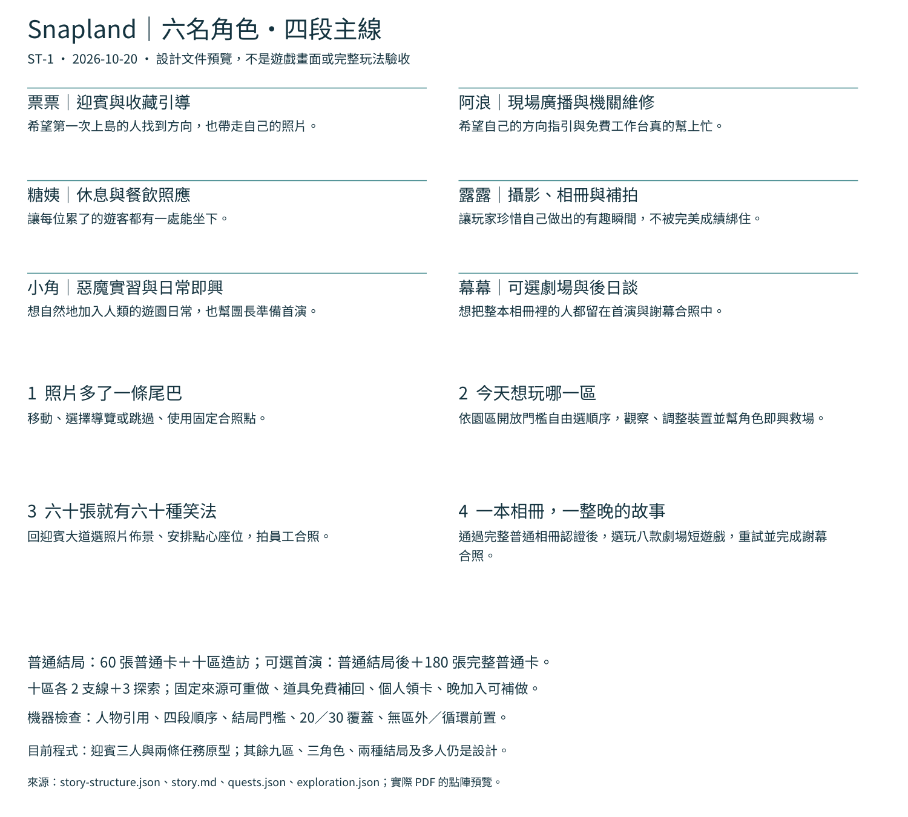

# [ST-1] 重整主線與園區支線

> 狀態：完成

## 內文

### 需求
用簡單、溫馨又帶喜劇的遊園故事支援自由探索與小遊戲樂趣；重設主線、二十條支線與探索事件，讓故事帶出操作而非反覆收集雜物。

### 來源
使用者於 2026-10-06 的 Snapland 對話要求依業界案例整理的樂趣核心重整設計並按票交付；設計基線見 design/06-roadmap/open-questions.md。

### 驗收條件
- [x] 六名重要角色、四段主線與普通结局、全集終區的關係一致。
- [x] 十區各兩條支線包含觸發、玩家行為、回報、回復與多人歸屬。
- [x] 每區有三個探索收藏事件，無永久錯過或晚加入鎖死。
- [x] 任務不依賴高難 AI、付費隨機獎勵或尚未開放區域。
- [x] 有可重現的劇情資料驗證結果與文件截圖。

### 測試流程
1. 閱讀交付規格並逐項對照驗收條件。
2. 執行受影響範圍的設計驗證，確認有效資料通過、錯誤資料能被拒絕。
3. 比對文件與截圖，預期全部條件可追溯且沒有虛報實際遊戲試玩。

---

# 跟其他票的關係
- Blocks：無
- Blocked by：無
- Related：無

---

# Commit-1

## 內文

完整故事已有二十條支線、三十個探索與四段主線，但人物引用和兩種結局的關係缺乏自動交叉檢查；文件也把迎賓原型與十區設計混成同一個「未實作」狀態。

現在六位角色各有清楚的工作、動機與喜劇失誤，四段主線有可核對的前後關係。普通結局維持六十張加十區造訪，可選首演在其後認證完整一百八十張普通卡，八款劇場收藏另冊。任務和探索的永久重做、免費恢復、單人可完成、個人領卡及晚加入補做有一致的設計規則。

本票接受的是完整設計與驗證。文件另列迎賓三人／兩條任務原型和完整場景目標的對照，不把資料檢查當成十區、兩種結局或多人已可玩。迎賓原型沿用同一固定卡，不新增收藏分母。

### 研究與流程

實際閱讀 A Short Hike、Alba、TOEM、Lil Gator Game、Failbetter、inkle 六方原文，並下載、查看 A Short Hike 官方靜態圖。採用自由選路、角色小事、可追蹤的短事件與未接結尾檢查；不採用永久消失或高難／付費門檻。[比較、圖例與採收界線](../../design/03-story/narrative-survey.md)。沒有宣稱觀看來源影片或六款遊戲試玩。

採用流程是先列人物／主線／恢復規則，再對照園區門檻與真正迎賓角色，最後以未知人物、錯誤結局門檻、循環前置、房主獨得及高難 AI 等反例驗證拒絕行為。

### 測試結果

| 項目 | 結果 |
|---|---|
| 五個設計範圍 | 園區、遊戲、劇情、物品與連結通過；沒有執行遊戲試玩 |
| 劇情資料／反例 | 16 項 Python 檢查通過；涵蓋六人四段、二十／三十覆蓋、結局、引用、區內依賴、恢復與歸屬 |
| 文件圖 | 實際 PDF 的點陣預覽已檢視；是設計文件，非 Godot 畫面 |
| 可重現紀錄 | [測試 log](images/ST-1-20261020-tests.log)、[完整資料驗證](images/ST-1-20261020-design-all.log)、[來源與範圍](images/ST-1-20261020-verification.json) |

### 截圖

開始基準 `056b5d4cba0bf7c907ad8a207c367aed95726c98`；分支 `codex/finish-runtime-batch-20261020`。完成範圍為本票設計條件；原生迎賓內容依 ST-2／3 的各自證據。
