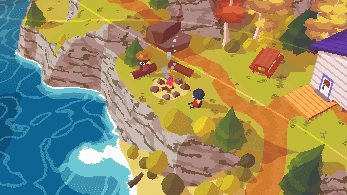
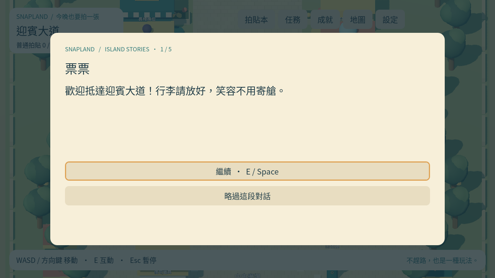

# [ST-2] 演出上島導覽與對話

> 狀態：進行中

## 內文

### 需求

從主角下船開始短導覽，帶入票票與小角；預留未來船上序章。

### 來源

使用者於 2026-10-11（Asia/Taipei）要求從上島開始實作主區域、迎賓大道全部小遊戲及共用系統；其他園區先做路口。每項實作前研究業界實例並保存圖例；本票是可執行第一版，品質以實際驗收為準。

### 驗收條件

- [x] 碼頭開場可跳過與重播；導覽帶出第一拍貼，跳過不失去進度。
- [x] 繁中對話有角色名、分段、前進與略過；能回到自由探索。
- [x] 實作前附劇情節奏與過場的已讀來源及圖例。

### 測試流程

1. 啟動遊戲，進入本票內容，依畫面提示實際操作。
2. 核對本票每項驗收條件，測試返回、重試、重開與輔助情境。
3. 保存原生畫面截圖與局部測試摘要；無法確認的項目保持未勾選。

---

# 跟其他票的關係

- Blocks：無
- Blocked by：MAIN-3
- Related：MAIN-1、SG-1、ST-1

---

## 開始基準

c1b7b19；feature/island-first-park。

# Commit-1

## 內文

問題：玩家尚無上島導覽與可讀對話。

改動：碼頭以五段短對話開始旅途，按玩家步調前進，可略過與重播，保留船上序章前接點。

驗收：原生開場畫面已查看；略過、重播、導覽取卡與返回自由探索通過。

分支：`feature/island-first-park`；開始基準：`c1b7b19`；[程式 commit](https://github.com/deadline314/Snapland/commit/f2d6b84919a91d534082660a12aec5a9b44eaa2c)。

### 測試結果

| 項目 | 結果 |
|---|---|
| 受影響局部驗證 | 本票相關runtime與主場景整合通過 |
| 原生畫面 | GPU擷取並查看；程式化操作驗收 |
| 遠端CI | 帳戶限制，工作未啟動；未重試 |

### 研究與圖例

[劇情與音訊研究](../../design/runtime/story-audio-research.md)。圖例為審閱參考，不是本作遊戲素材或試玩證據。

### 截圖

[整組驗收、票況與存檔事故紀錄](../first-playable-delivery.md)。
