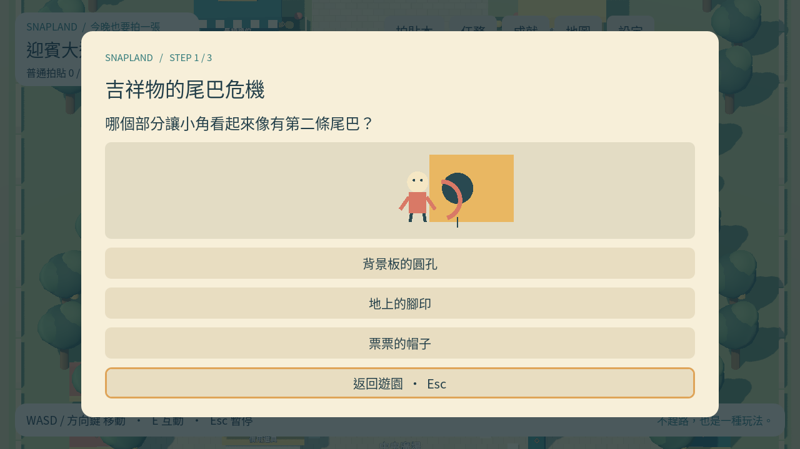

# [ST-3] 實作迎賓任務與探索

> 狀態：完成

## 內文

### 需求

完成迎賓兩條支線、三個探索及主線合照，以實際互動取得六張拍貼。

### 來源

使用者於 2026-10-11（Asia/Taipei）要求從上島開始實作主區域、迎賓大道全部小遊戲及共用系統；其他園區先做路口。每項實作前研究業界實例並保存圖例；本票是可執行第一版，品質以實際驗收為準。

### 驗收條件

- [x] 小角的尾巴彩帶試拍與阿浪的廣播即興救場各三個可操作步驟，有任務追蹤。
- [x] 花壇、影子、長椅與主線合照可操作取卡，重做不重複領取。
- [x] 未完成步驟保存，退出與重開能接續，不會鎖死。

### 測試流程

1. 啟動遊戲，進入本票內容，依畫面提示實際操作。
2. 核對本票每項驗收條件，測試返回、重試、重開與輔助情境。
3. 保存原生畫面截圖與局部測試摘要；無法確認的項目保持未勾選。

---

# 跟其他票的關係

- Blocks：無
- Blocked by：MAIN-3
- Related：MAIN-1、SG-1、ST-1

---

## 開始基準

c1b7b19；feature/island-first-park。

# Commit-1

## 內文

問題：首區支線與探索尚無玩家可操作內容。

改動：尾巴危機與廣播救場各有三步，另可讓花壇眨眼、對齊影子及借立牌合照，保留任務進度。

驗收：原生任務與主場景整合通過，錯誤操作不推進，完成取卡、重做去重及重開接續通過。

分支：`feature/island-first-park`；開始基準：`c1b7b19`；[程式 commit](https://github.com/deadline314/Snapland/commit/f2d6b84919a91d534082660a12aec5a9b44eaa2c)。

### 測試結果

| 項目 | 結果 |
|---|---|
| 受影響局部驗證 | 本票相關runtime與主場景整合通過 |
| 原生畫面 | GPU擷取並查看；程式化操作驗收 |
| 遠端CI | 帳戶限制，工作未啟動；未重試 |

### 研究與圖例

[劇情與音訊研究](../../design/runtime/story-audio-research.md)。圖例為審閱參考，不是本作遊戲素材或試玩證據。

### 截圖

[整組驗收、票況與存檔事故紀錄](../first-playable-delivery.md)。

# 2026-10-20 現行第一版結案

依目前實作核對兩條三步任務：小角互動→長椅構圖→自己的角色泡泡合照；阿浪互動→迎賓牆取景→人潮號誌。錯誤證據與練習結果不推進、未完成不授卡、完成後再觸發不重複授卡。Main故事整合實際走到探索取卡、未完成票重開、首次教學／離開重進及自然人潮完成後的任務回報；兩個新程序另保留quest-001第2步及完整進度。三探索與guide固定來源、去重由Main整合與核心回歸覆蓋。沒有把直接餵入事件的規則測試當成整條泡泡任務的真人自然通關影片。

[Main實際互動／任務整合](../Snapland-art/images/ART-23-verify-20261020-main-story-integration-tests.log) · [任務事件／拒絕／冪等](../Snapland-art/images/ART-23-verify-20261020-story-runtime-tests.log) · [真正新程序保存](../Snapland-main/images/MAIN-6-restart-20261020-verification.json)。既有實作與原程式f2d6b84已在main，本輪核對當前規則及證據，不把早期feature狀態當目前阻塞。舊Windows圖仍屬歷史；本輪無頭功能檢查、原生自動輸入與合成UI各按實際範圍記錄，沒有新Windows EXE、真人試玩或聽感認證。

任務名稱對齊現在的角色動機與實際步驟，未減少三步／三探索／固定獎勵／保存條件。ST-4更深入的角色演出與ST-5語音聽感仍保持進行中；本結案不是全島劇情或全部角色動畫完成。
