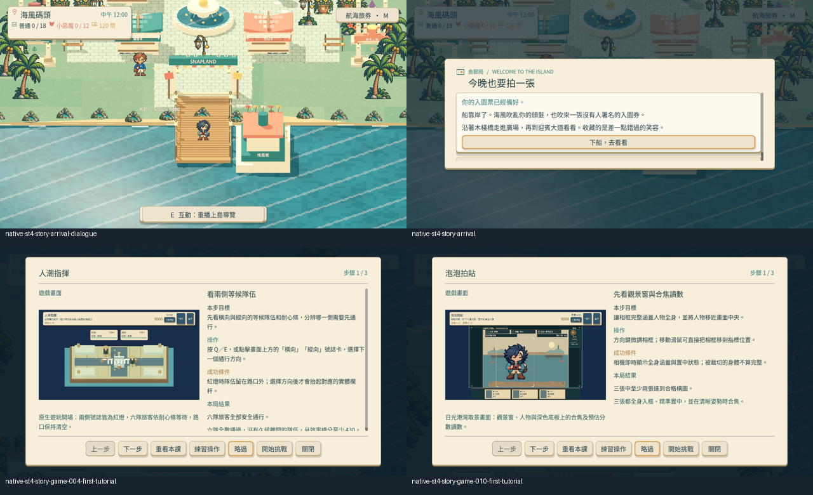
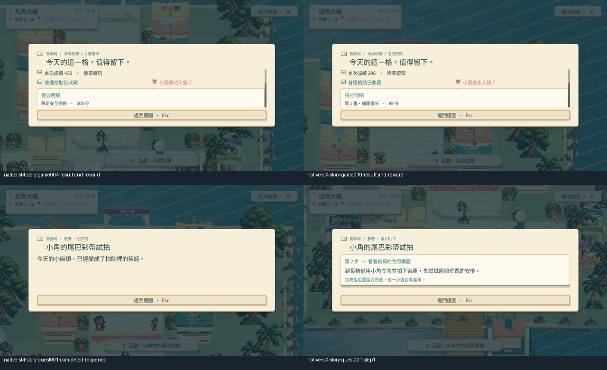
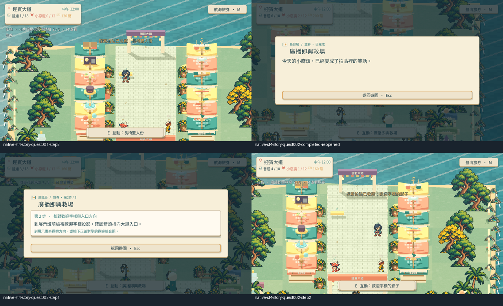
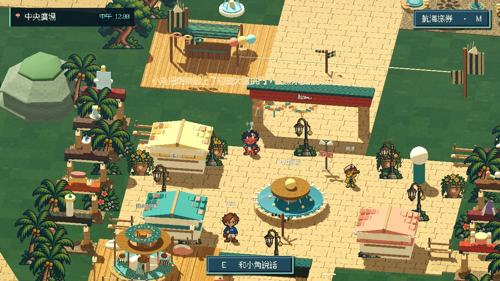
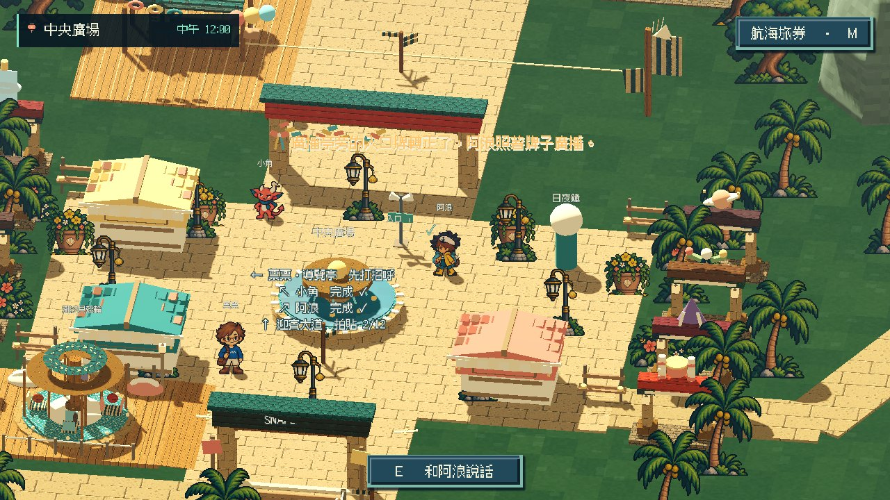
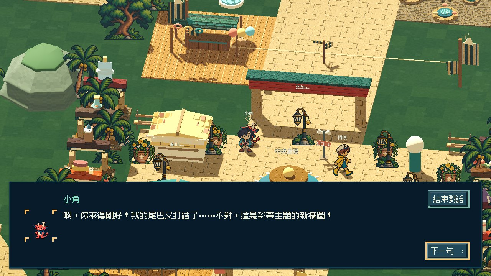
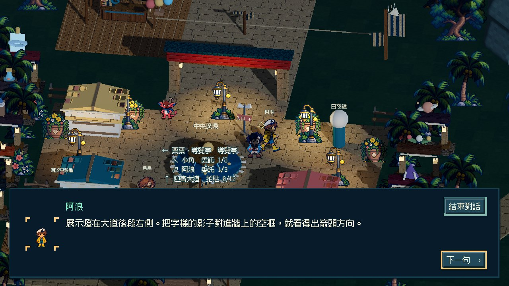

# [ST-4] 深化迎賓角色與園區故事

> 狀態：完成

開始基準：`783c7ea6aa6c31fd95147da2139096ab280a85ef`；分支：`feature/island-first-park`。

## 內文

### 需求
完善上島後的主線、支線和角色互動，讓三位 NPC 的性格、動畫、任務和遊樂園設施互相支持。對話精簡而有特色，任務有合理動機及可見回應；船上序章維持未來銜接。

### 來源
2026-10-12（Asia/Taipei）使用者要求全面重新審閱 UI 和小遊戲，提升目標、計分及操作手感；先廣泛 survey，減少遊戲當下提示，提供含截圖的完整教學。使用者授權自行決定設計，強調循序完善、細節有主次且不雜亂，以可面向大眾的品質驗收。

### 驗收條件
- [x] 參考至少六個不同團隊的角色、任務與敘事實例，保存實際閱讀內容及採用理由。
- [x] 上島與首區主線及支線有清楚動機、角色差異和可觀察的結果，避免只按確認、領獎的空洞任務。
- [x] 對話、任務、動畫、收藏及時段條件一致，跳過或重開不破壞進度，也不重複發獎。
- [x] 新存檔與續玩以原生操作驗收，保留角色對話及任務演出影片、截圖和測試。

### 測試流程
1. 查看本票研究紀錄與圖例，核對採用的原則和原生前後比較。
2. 使用隔離存檔實際操作本票完整流程，核對各項驗收條件。
3. 核對重試、返回、重開與相關設定，保存原生截圖、影片和受影響測試摘要。

---

# 跟其他票的關係

- Blocks：無
- Blocked by：無
- Related：ST-2、ST-3、MAIN-11、ART-17

---

# Commit-1

## 問題

迎賓任務的行動與角色動機連結不足；任務卡也曾顯示內部步驟名稱，玩家難以理解當前目標。

## 改動

小角請玩家試看長椅雙人構圖，再完成泡泡相機全身試拍；阿浪請玩家核對現場指引，再成功完成人潮指揮。正式成果會自動蓋章，練習不推進旅券。任務卡顯示清楚的目標與進度，保存、重開和重訪不重複發獎。六個不同團隊的敘事與任務設計閱讀紀錄及取捨已保存於[研究紀錄](../../design/runtime/first-park-story-quality.md)。

## 驗收

Root 使用隔離存檔完成上島對話、兩條任務、探索拍照與兩款正式小遊戲：泡泡相機自然成功 296 分，人潮指揮自然成功 430 分；兩條旅券及其照片獎勵保存後重開一致。實際看過全部十二張原生截圖並播放 28.733 秒影片至結尾。這段驗收只省略站點間行走，未直接改分數、任務進度或獎勵；不是完整自由探索試玩。任務演出、全時段整合與完整 NPC 動畫仍以未勾選條件追蹤，票維持進行中。

### 測試結果

| 項目 | 結果 |
|---|---|
| Main 任務互動、教學重入及自然結果生命週期 | 通過；exit 0，無錯誤 |
| 故事資料、證據與重複獎勵保護 | 通過；exit 0，無錯誤 |
| 主場景整合 | 通過；exit 0，無錯誤 |
| 核心存檔完整往返 | 通過；exit 0，無錯誤 |
| 最終原生任務流程 | 通過；1724 幀 / 60 FPS，無錯誤 |

### 截圖與影片

[原生流程影片](images/ST-4-final-native-flow.mp4)。十二張原圖以 `ST-4-final-` 開頭保存在本票 images 資料夾。

分支：`feature/island-first-park`。本輪程式與原生證據：[61fb5de](https://github.com/deadline314/Snapland/commit/61fb5de200cbc0eb805a01ed5dd1f9378399e634)。

# Commit — 2026-10-23 回訪對話與看得到的委託成果

## 問題

小角和阿浪不論委託做到哪一步都說同一段話，完成後再找他們只會重開一張「已完成」卡；票票第一次對話後也沒有新內容。玩家做的事沒有在角色或島上留下痕跡。

## 改動

三位角色改依保存的進度挑話：條件最具體的一段優先，同樣具體時輪到最久沒聽過的一段。小角從請求、提醒長椅，到看了玩家拍的長椅合照後指向泡泡相機；阿浪從箭頭被調換、指路到展示燈，到確認方向後交出路口號誌。票票會依玩家幫了誰、兩件都完成或還在進行說不同的話。每位角色在四個時段各有一句自己的旁白，同一時段只說一次。

完成小角的委託後，迎賓大道拱門掛上三色彩帶與蝴蝶結；完成阿浪的委託後，廣播角旁的入口牌從指回碼頭的「入口 ↓」換成「入口 ↑」。之後再找他們只會聊成果並做出慶祝動作，不再重開卡片；從「今日任務」打開的完成卡會寫出這個成果。在小遊戲裡完成時，回到園區會以一行提示告知。

## 驗收

| 項目 | 結果 |
|---|---|
| 研究 | 六個不同團隊（Emily Short、Valve、Secret Lab、inkle、A Short Hike、Campo Santo）的實際閱讀內容與採用／不採用理由，見設計紀錄 |
| 選段與資料 | 小角／阿浪四個步驟各對到正確段落；票票六種進度各對到正確段落；未完成時不會說出「綁上」「轉正」；時段旁白只在換時段時出現；缺後備或未知條件的資料會被拒絕 |
| Main 實際互動 | 每步回訪的段落、完成後只聊天不開卡、第二次換一句、照片／金幣／進度不變、票票注意到玩家完成了阿浪的委託；重新載入後入口牌仍轉正、沒有重播上島 |
| 慶祝動作 | 小角跳舞、阿浪廣播動作都有作者原畫並實際播放 |
| 原生故事全流程 | 隔離新存檔，真實輸入完成兩條委託（長椅與歡迎牆實拍、泡泡相機與人潮指揮自然成功），兩次存檔重開，13 張畫面；exit 0、0 ERROR |
| 原生新存檔／續玩流程 | 步行 194 公尺走過三位角色與三處路標，切換凌晨／傍晚／晚上，存檔後以新的 Main 續玩，進度與照片不變；220.9 秒影片 |

原生操作以程式送出真實鍵盤與滑鼠事件；故事全流程在站點間只移動玩家位置，沒有直接設定分數、委託進度或獎勵。這些是腳本驗收，不是真人試玩。共用機器負載很高時，故事全流程用 `SNAPLAND_REVIEW_WALL_SCALE=15` 放寬等待時間，遊戲時間、輸入與計分不變；另修正腳本裡已過時的快門按鈕文字。

[研究、設計與驗證界線](../../design/runtime/island-reactive-story.md) · [原生流程影片](../Snapland-main/images/MAIN-11-flow-20261023-walk.mp4) · [流程紀錄](../Snapland-main/images/MAIN-11-flow-20261023-report.json)

分支：`work/story-explore`（自 `2e95cc6` 開始）。
