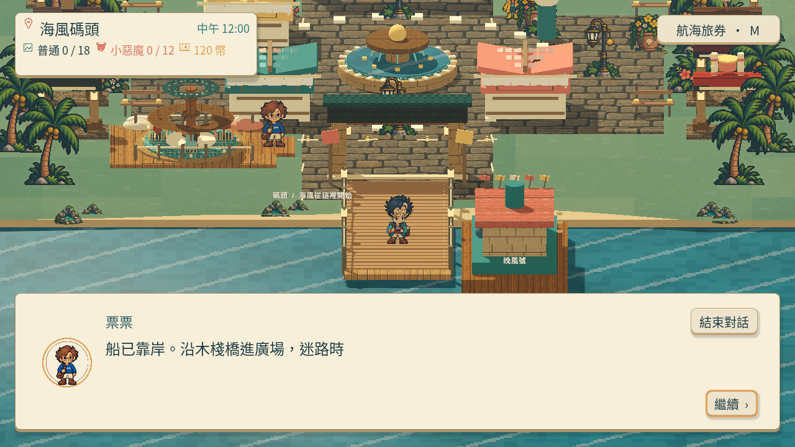
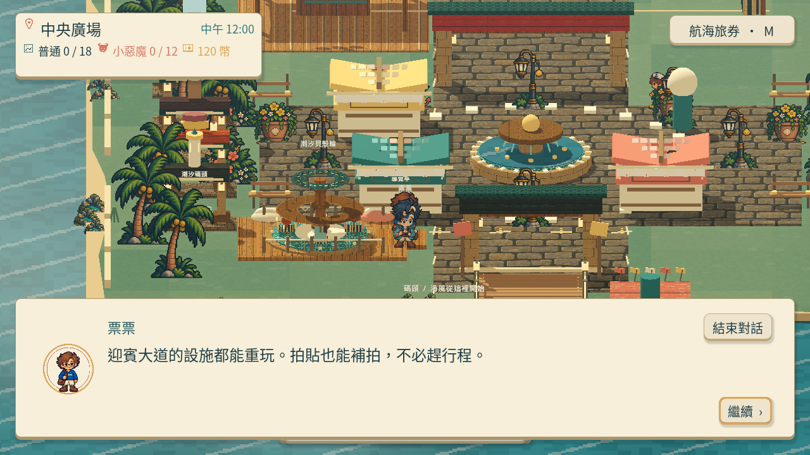
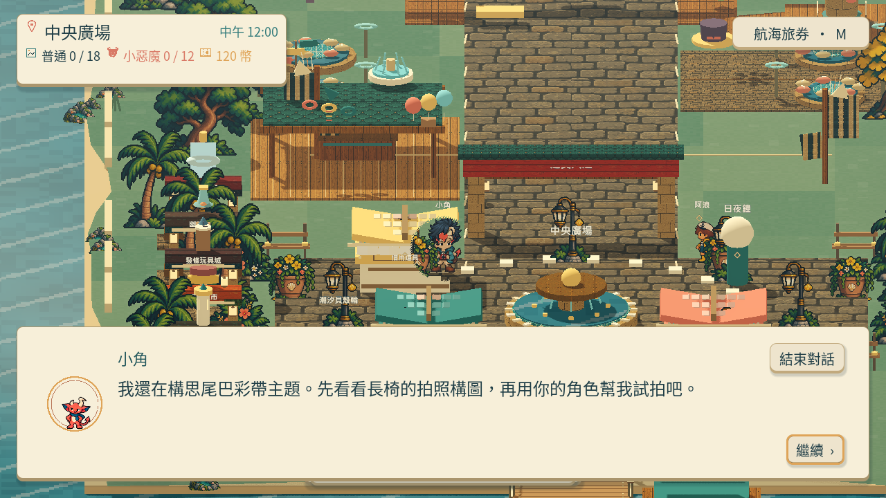
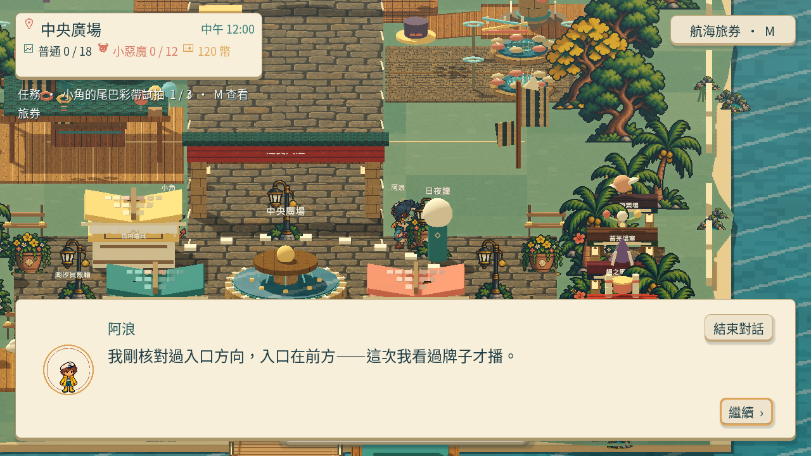
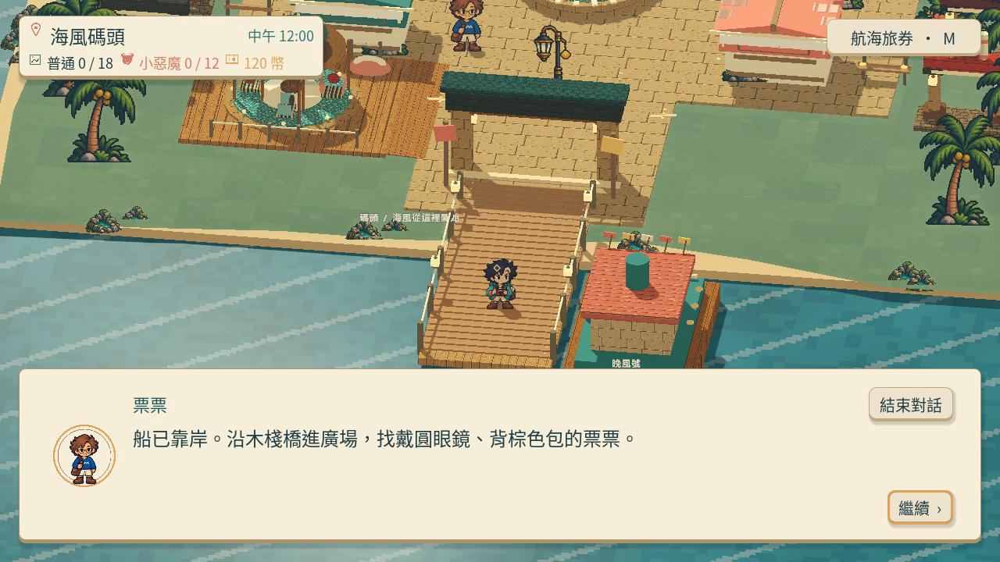
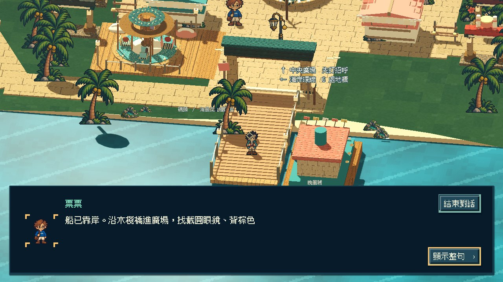
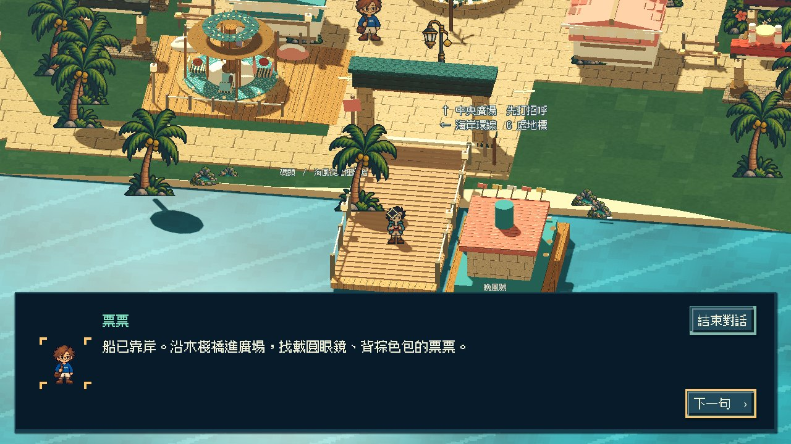

# [ST-5] 提供全角色對話與滴滴語音

> 狀態：進行中

## 內文

### 需求

島上每個出現的角色可對話；使用真正對話框呈現姓名與內容，文字出現配上節制的滴滴聲。不同角色有個性，對話融入場所、時段及園區活動。

### 來源

2026-10-13（Asia/Taipei）使用者試玩回饋，要求先完善島上體驗：角色頭髮分離與動畫怪異、真正 HD-2D、特色攤位、全角色對話、探索與遊樂設施、符合玩家習慣的拍貼與介面。設計自主決定，至少六個多方向實例，研究與實際畫面分開記錄。

### 驗收條件

- [x] 島上所有角色可從所在位置觸發對話；對話不是通用功能選單。
- [x] 對話框有姓名、逐字顯示、完成當句與下一句操作；滴滴聲不對空白和標點連播，服從音效音量。
- [x] 對話中角色停止移動，結束或取消恢复探索；任務與首次上島進度保持正確。
- [ ] 原生逐一與所有角色對話並實際試聽，保存畫面、影片及局部測試摘要。

### 測試流程

1. 使用獨立存檔從上島開始，操作本票涉及功能。
2. 依每項條件確認玩家可見行為，核對返回、重訪、時段與降低動態。
3. 查看原生畫面及正常與慢放影片；需要聲音時實際試聽，保存證據。

---

# 跟其他票的關係

- Blocks：無
- Blocked by：無
- Related：ST-2、ST-4、MAIN-11、MIC-2

---

## 本輪開始

固定基準：`97e7ee8`；分支：`feature/island-experience`。2026-10-13 島上試玩改善依使用者回饋重新驗收，不以舊版畫面或數據檢查替代本輪遊玩。

# Commit-1

## 內文

問題：上島與角色互動原本先出現功能面板，對話框的內容和按鈕也曾超出畫面。

改動：下船直接開始一般對話；票票、小角、阿浪都可交談。姓名、逐字文字與下一句放在底部完整對話框，按 E、空白鍵或按鈕可先顯示當句，再繼續；取消安全返回遊園。

驗收：已在原生畫面逐一開啟三位角色對話，查看內容、取消與返回；正常速度及四分之一速度流程錄影已保存。另以本票的實際提交內容建立獨立測試副本，對話、故事與主場景整合皆通過，無腳本或引擎錯誤。不同角色滴滴聲、標點略過與音量控制通過局部程式驗證；錄影使用無聲測試驅動，實際試聽仍待本機原生驗收，票維持進行中。

### 測試結果

| 項目 | 結果 |
|---|---|
| 本票提交內容匯入／對話／故事／主場景整合 | 4 項通過；0 ERROR |
| 對話框 1280×720、800×450 邊界 | 通過 |
| 原生三位角色交談與取消 | 已查看 |
| 實際滴滴聲試聽 | 待本機原生驗收 |

### 截圖與影片

[正常流程](images/ST-5-native-normal.mp4) · [四分之一速度](images/ST-5-native-quarter.mp4)

錄影以實際鍵鼠事件操作，站點間有測試傳送；這段證據確認對話操作，不是整島自由試玩。共同背景改善另由 MAIN-11 驗收。分支：`feature/island-experience`；[遠端功能提交](https://github.com/deadline314/Snapland/commit/4c95f00b0d92e562fa13c022ff4e51ba9cd20762)。

# Commit-2

### 問題
上島對話仍引導玩家找不存在的亭上藍色箭頭，與目前廣場配置不符。

### 改動
抵達時改以木棧橋、廣場及票票的圓眼鏡和棕色包引路，讓對話指向玩家實際看得到的人與位置。

### 驗收
以本次提交內容建立獨立副本，故事、故事整合、對話及主場景四項局部測試通過。原生啟動錄製 240 格／60 FPS；主 Session 實際查看完整對話截圖，文字正確且沒有被介面截斷，執行記錄沒有 ERROR。這是啟動與文字驗收，沒有把它當成自由試玩或音效試聽。

分支：`feature/island-experience`；本輪文字基準：`d3d98a4`。[文字與原生畫面提交](https://github.com/deadline314/Snapland/commit/5eb08b6)。

# Commit — 2026-10-23 對話操作標示與滴滴聲 PCM 對字

## 問題

對話框的「繼續」鍵不說明按下會發生什麼：逐字中按一次是顯示整句，再按才換下一句，最後一句又是結束。滴滴聲的間隔用電腦時鐘計算，畫面卡頓或離線錄影時與文字節奏脫節；引號、括號與全形空白也會發聲。先前只有局部程式檢查，沒有對照實際輸出的聲音。

## 改動

同一顆鍵依狀態顯示「顯示整句 ›」「下一句 ›」「完成 ›」，E、空白鍵與滑鼠相同。滴滴聲改跟逐字顯示的遊戲時間走，引號、括號、全形空白與分隔點都不發聲，音效音量為零時完全不響。另加一個工具，把錄下的聲音逐段對照當時顯示的字，確認每聲都對得上字、說話者音高也正確。

## 驗收

隔離新存檔以程式送出的真實鍵盤／滑鼠事件走完上島、三位角色與四個時段的對話；以 Movie Maker 15 FPS 錄下 220.9 秒影像與 48 kHz 聲音（這是離線錄製的固定節拍，不是即時試玩）。

| 項目 | 結果 |
|---|---|
| 逐字中按 E | 第 20／27 字時按下，整句立即顯示，仍停在同一句；按鍵文字由「顯示整句」變「下一句」，最後一句為「完成」 |
| 錄音對字 | 294 聲全部落在有新字顯示的影格，且音高都屬於當時說話的角色；只出現標點的 20 個影格全部無聲；整句跳過時沒有連發 |
| 間隔 | 最短 62.4 毫秒（15 FPS 下每格最多一聲；即時遊玩的角色間隔為 42–54 毫秒） |
| 音效音量 | 從設定滑桿改為 1.0／0.5／0：各 24／24／0 聲，0.5 的峰值正好是 1.0 的 0.50 倍 |
| 場景其他聲音 | 7 處與主角音高相同、約 4.8 秒一次的環境音出現在沒有對話文字的時段，另列不計為滴滴聲 |
| 局部測試 | 對話面板與滴滴聲、Main 故事整合、音訊、主場景整合通過；新增 PCM 對字工具 3 項 Python 反例（含錯位、錯音高與半音量） |

以上是聲音波形與時間的技術核對，**沒有以喇叭或耳機實際試聽**；「原生逐一與所有角色對話並實際試聽」維持未勾選，票維持進行中。主場景整合在負載很高的共用機器上曾有一次未保存原因的失敗，重跑兩次（含單獨執行）皆通過。

[錄音對字結果](images/ST-5-flow-20261023-beeps.json) · [原生流程影片（含聲音）](../Snapland-main/images/MAIN-11-flow-20261023-walk.mp4) · [完整流程紀錄](../Snapland-main/images/MAIN-11-flow-20261023-report.json)

分支：`work/story-explore`（自 `2e95cc6` 開始）。
