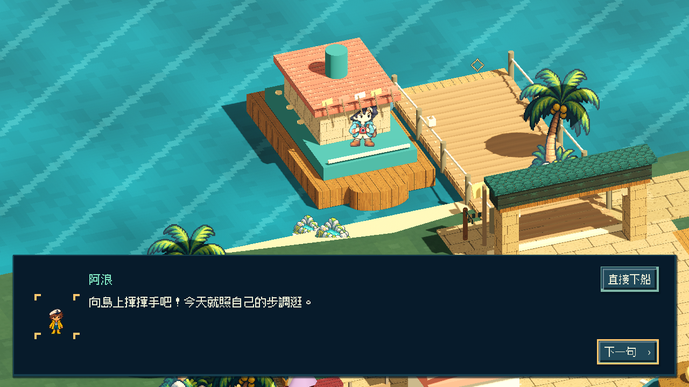
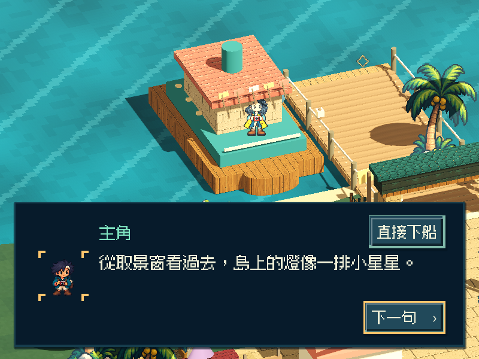
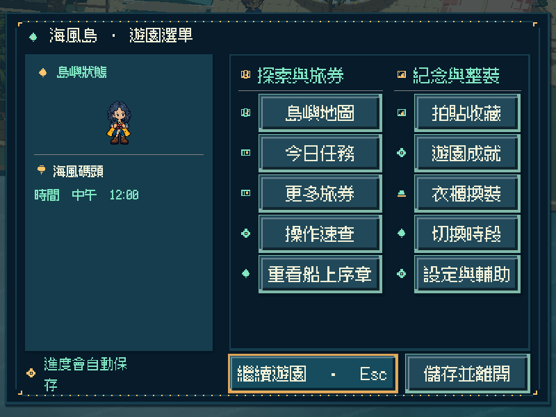
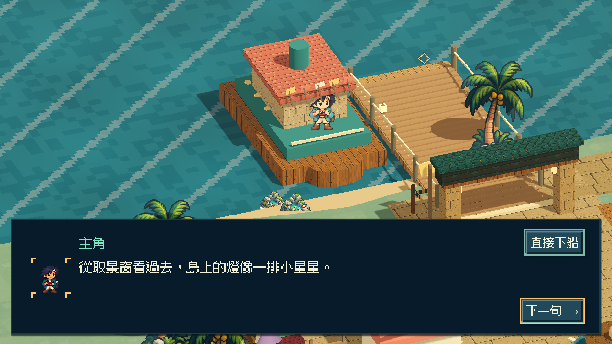

# [ST-6] 完成晚風號船上序章

> 狀態：完成

## 內文

### 需求
首次遊玩先在晚風號上看見自己的角色，透過短對話整理相機、望向島嶼，再接上碼頭導覽；可隨時略過並於日後重播。

### 來源
2026-11-12 使用者要求接續完成整個遊戲，必要時開新票並實際交付。原 ST-2 僅完成下船後導覽，船上序章仍為預留內容。

### 驗收條件
- [x] 首次遊玩有完整船上場景與可依玩家步調前進的短演出，銜接既有碼頭導覽。
- [x] Esc 與畫面按鈕可略過，暫停選單可重播；結束後鏡頭、人物與操作正確恢復。
- [x] 舊存檔不被強迫重看，完成與略過可保存；欄位損壞或保存失敗可安全繼續，不影響既有收藏與金幣。
- [x] 角色保留目前外觀與完整身形，降低動態、重入、800×600 與放大文字下可操作且可讀。
- [x] 隔離存檔的局部測試、原生畫面及打包播放證據附票。

### 測試流程
1. 使用全新隔離存檔正常完成與略過船上序章，確認兩條路徑皆銜接碼頭導覽。
2. 載入舊存檔、重播與中途退出，核對位置、鏡頭、外觀、收藏及金幣。
3. 切換降低動態與不同視窗／文字尺寸，記錄原生畫面並於輸出包重做。

---

# 跟其他票的關係
- Blocks：無
- Blocked by：無
- Related：ST-2、ST-5、MAIN-3、ART-17

---

# 開始
固定基準：`2dcb765`；分支：`codex/boat-prologue-20261112`。

---

# Commit-1

## 內文

新玩家從晚風號甲板上的五段短對話開始，整理相機、望向島嶼並準備上岸；可依自己的步調前進，或直接下船銜接原導覽。暫停選單可重播，結束回到原地，不重複授予收藏或金幣。

舊存檔不被強迫重看；保存失敗仍可繼續導覽，原進度保持完整。重播、略過、對話中斷與關閉遊戲都還原鏡頭和人物操作；退出後不再重新啟動音效。三種原生尺寸已核對完整身形、甲板、字幕及控制項。

### 測試結果

| 項目 | 結果 |
|---|---|
| 變更前局部基準 | 7／7 通過 |
| 船上、故事、對話與選單回歸 | 9／9 通過；完成後船上與啟動另核對 5／5 |
| 測試完成判定與失敗診斷 | 17／17 通過，不接受遺漏、重複或其他非預期錯誤 |
| Linux／Windows 保存失敗與退出 | 兩平台各 2／2 局部檢查通過，強制退出事件不重啟音效 |
| 原生尺寸與外觀 | 800×600 降低動態／1.25 文字、1280×720、1920×1080／1.25 文字各十張；含捲髮與短髮、雨背心、目前外觀保留 |
| 隔離資源包 | 預設光影下首次播放、五段演出、原導覽與重播，各項控制及十張畫面通過 |
| Windows 成品 | 全新隔離存檔啟動與關閉通過，十二款原遊戲圖資及原生截圖通過 |
| 完整雲端驗證 | 內容提交 `8512937` 的 [執行 43247479202](https://github.com/deadline314/Snapland/actions/runs/43247479202) 通過；182 項 Python 測試與全部 104 項遊戲檢查 |
| 執行紀錄 | 沒有非預期 ERROR；故意保存失敗僅接受精準的一次預期診斷；保留原建物材質警告 |

程式化操作及畫面檢查不代表真人遊玩或真人試聽。實作與測試提交：`a23dd1d`、`d73ad04`、`16ab825`、`8512937`。

### 截圖

[證據索引](images/ST-6-boat-20261112-evidence-index.md)；[完整原生畫面、測試與審查證據](images/ST-6-boat-20261112-evidence.zip)；[成品來源與指紋](images/ST-6-boat-20261112-verification.json)。
