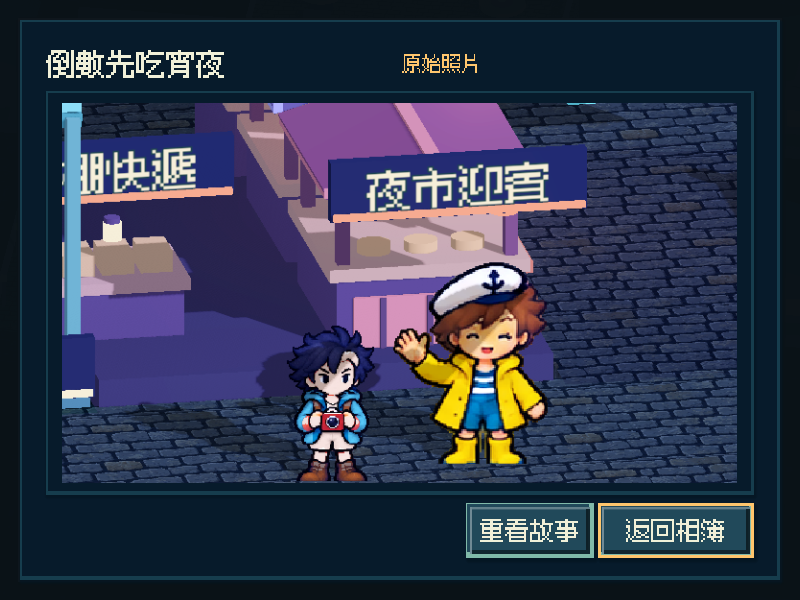

# [ST-7] 演出霓虹夜市主線合照

> 狀態：完成

## 內文

### 需求

玩家抵達霓虹夜市後可在固定迎賓點和當班的阿浪交談。他用夜市的小插曲透露幕幕在籌備首演，玩家可直接跳到合照。完成第一次合照取得該區主線拍貼並登記造訪，之後可重看演出與合照。

### 來源

2026-11-26，使用者要求持續交付後面章節與可玩內容。故事設計第二幕「自由巡園」規定各區有固定迎賓點、當班角色與無成績門檻的主線合照。

### 驗收條件

- [x] 夜市入口附近有可步行到達的迎賓點，持入場資格即可進行，不需贏指定遊戲。
- [x] 阿浪的短對話有夜市笑話及幕幕首演線索，可略過直接合照。
- [x] 玩家在看得到角色的場景操作快門，首次成功後同時取得主線拍貼與造訪登記。
- [x] 收藏本顯示夜市主線來源，可重看與重拍；重播不重複增加收藏或造訪。
- [x] 取消與保存失敗皆可回到原點重試，舊存檔及夜市原有操作仍有效。
- [x] 局部、原生流程和存檔重開通過，PM 留摘要與一張代表截圖。

### 測試流程

1. 使用六張其他普通卡到夜市迎賓點，交談後親自按下快門。
2. 從收藏本重看對話，略過後重拍，檢查卡片與造訪數。
3. 在拍照前取消與模擬保存失敗，再重試並從隔離存檔重開。

---

# 跟其他票的關係

- Blocks：無
- Blocked by：無
- Related：無

# Commit-1

## 內文

首次到夜市可找阿浪，聽他聊宵夜插曲和幕幕的首演。玩家可以略過對話，在夜市實景用快門拍下兩位角色。拍貼與造訪同時保存，重看或重演保留原照和原有收藏數。

### 驗證摘要

- 原生實際操作通過 1280×720 共 30 項、800×600 共 31 項、1920×1080 共 30 項，獨立程序另驗證讀回 18 項。
- 局部測試涵蓋實際接近、略過、快門控制邊界、鏡頭回復、寫入失敗回滾及收藏本重播。
- 內嵌 Windows 成品完成 30 項，另開程序讀回 6 項。

