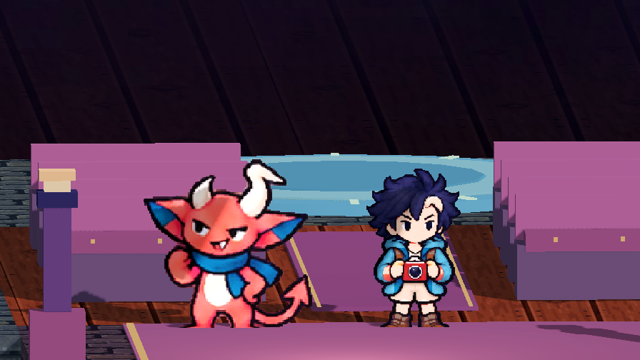

# [ST-9] 演出鏡之馬戲團主線合照

> 狀態：完成

## 內文

### 需求

在馬戲團入口接通小角的一段迎賓短對話和實景合照。首次合照取得一張固定普通主線拍貼並登記造訪，之後可從相簿重看。

### 來源

2026-11-26 使用者要求接續後面章節。第二幕「自由巡園」安排各區的迎賓笑話與合照，逐步帶出幕幕正在準備首演。

### 驗收條件

- [x] 依原門檻進入馬戲團後，步行到迎賓點並與小角交談，可略過到合照。
- [x] 合照呈現實際帳篷場景及兩位角色。取消可返回原位。
- [x] 首次成功保存同時登記到訪與主線普通卡。保存失敗可重試。
- [x] 相簿可重演。重拍、跨區重看和重新啟動都保有原照與原收藏。

### 測試流程

1. 走到馬戲團迎賓點，交談、略過，先取消一次再拍照。
2. 核對收藏、原圖與到訪。從相簿重演並返回。
3. 往返迎賓大道，核對跨區重看，再用相同隔離存檔重開。

---

# 跟其他票的關係

- Blocks：無
- Blocked by：無
- Related：無

---

# Commit-1

## 內文

入口與小角交談，從排練笑話得知幕幕在準備首演。可直接略過到帳篷合照。正式保存只增加一張普通主線卡及一次造訪，從相簿重演時保留首次原照。

### 測試結果

| 項目 | 結果 |
|---|---|
| 原生視窗與重開 | 800×600、1280×720、1920×1080，125% 字級，正式快門與重開均通過 |
| 隔離回歸 | 29／30 張門檻、步行與取消復位、跨區重看、保存失敗後重試通過 |
| 既有夜市收藏 | 載入實際舊檔原照，校驗一致，重演保留原圖 |

### 截圖

