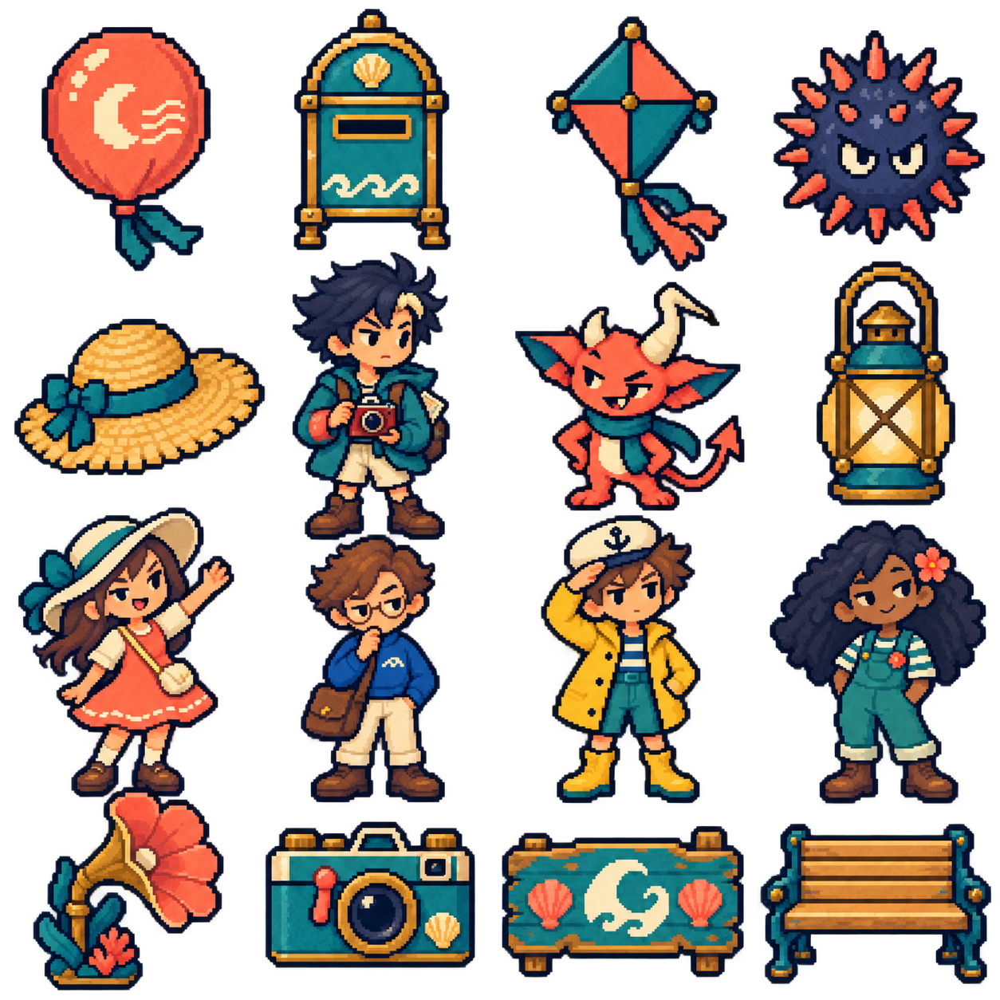
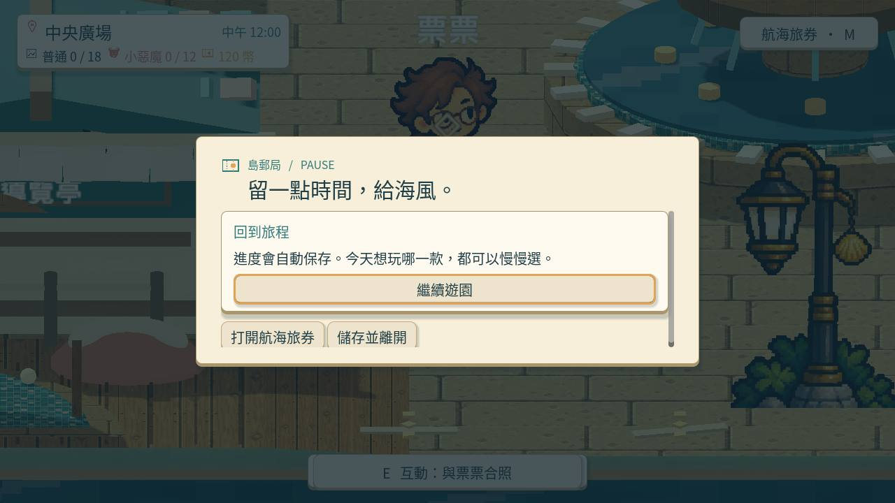

# Snapland 使用者需求與品質指南

整理日期：2026-10-15（Asia/Taipei）。這份指南整合使用者歷次要求與更正；**需求、喜好與驗收結果分開看，寫在這裡不代表已實作。** 更新相關需求時維護對應段落，不再只按日期追加重複內容。

- [下一個 Session 可直接使用的 Prompt](next_session_prompt.md)
- [本次整理與驗收：MAIN-20](Snapland-main/[MAIN-20]整理需求指南與接續提示.md)
- 固定規範另見 [AGENTS.md](../AGENTS.md) 與 [pm-ticket](../.agents/skills/pm-ticket/SKILL.md)；使用者最新明確指示優先。

## 1. 當前優先順序與完成標準

1. **先雕琢島上的實際體驗**，把主區域與第一園區做成能作為後續園區標準的完整體驗。先修主角／NPC 動畫、真正的 HD-2D、探索與設施、對話和整套 UIUX，不急著擴張更多簡陋內容。
2. 從主角上島開始；未來另做船上世界觀序章，現在保留前接點。主區域與第一園區需要完整可玩，其他園區先有清楚且有特色的路口。
3. 可以一步一步做，品質優先於速度；不要停在研究、生成素材、單張截圖或半完成展示。使用者已授權自主做常規設計判斷，不需要反覆詢問是否繼續；遇到實質歧義或不可逆操作再澄清。
4. 精品指的是畫面、操作、目標、地圖、角色、故事、音樂與音效共同成立。細節要有主次、留白與辨識度，不能用雜亂、特效或大量文字掩蓋空洞設計。
5. 新的試玩回饋優先於舊的「已看過／通過」。使用者再次指出怪異、簡陋或不好用時，要重新找原因，不能沿用舊驗收結論。

## 2. 島嶼與探索：真的在遊樂園玩

- 地圖需要有探索慾望、清楚地標、有意義的動線、主線／支線／角色與可發現內容，不能只把小遊戲入口機械式排成一列。
- 加入有島嶼特色、玩家能親自玩的遊樂設施、休閒活動與拍貼，讓移動和停留本身有樂趣。
- 攤位依玩法有自己的造型、空間和接近方式；開始介面簡潔直接，不把每個攤位做成同款複雜面板。
- 使用者指定參考**《炸彈超人樂園3》**的園區、設施、人物與探索組合。研究實際設計方法，不能只寫名稱或照抄配置。
- NPC 放在容易辨識且不被建築擋住的地方。所有出現的角色都可用正常對話框交談，先以節制的滴滴聲配合逐字文字。

## 3. 美術方向：高精緻像素 HD-2D、有自己的性格

- 遊園是**細緻像素角色結合立體環境、完整光影、遮擋與動態的 HD-2D**；不是簡陋像素放大、平面背景貼圖，或加景深／泛光就算完成。
- 避免通用 AI 插畫感，尤其角色缺乏個性、背景過度華麗卻沒有可玩的空間，以及材質、透視、細節密度不一致。
- 角色要有可辨識的臉、比例、髮束、輪廓、性格和專用動作。世界需要自己的特色，不能把某位作者或單一作品的設計擬合成整個遊戲。
- 生成前研究提示詞與製作方法，明確限制比例、色盤、材質、構圖、動作與身份細節。生成工具、提示詞、來源圖及雜湊需可追溯；不合格就修正／拒收，不能只靠描述詞聲稱精品。
- 指定的四格海港／廣場／夕陽舞台／月夜背景曾被指出「太 AI」，需要重新處理像素語言與場景合理性，追蹤 ART-19。
- 「潮汐紙劇場」、青綠／珊瑚色與木銅海港是先前實作方案，不是使用者要求永久鎖定的材質或 UI 模板；使用者已明確否定舊紙卡式 UI，不能藉風格名稱把它恢復。

### 使用者實際肯定的兩個參考

第一張回饋：「這個其實我覺得還不錯」。可參考海港物件、像素細節與角色整體感；不等於整套素材、動作或每個 NPC 都已通過。

第二張回饋：「不過這個確實更有個性，也很好」。更鮮明的眉眼、髮型、姿態與人物性格是重要方向；不是只增加顆粒或把臉換成同一種可愛表情。

## 4. 動畫：整個角色自然、完整、一致

- 主角與每位 NPC 都要有自己的專用站姿、呼吸／眨眼、待機小動作、行走起停／轉向、招呼、互動、情緒與符合個性的專用動作。先完整做好主角、票票、小角、阿浪。
- NPC 可以服務、拿盤子、巡走、跳舞等；動作和停留節奏因人而異，不要全場同步、永遠招手，或把不斷表演當自然生活感。
- 步行需要自然重心、兩步交替、起停與轉向；主角採八方向並增加真正有意義的姿勢，NPC 依實際活動製作完整方向覆蓋。不能用重複幀、插值重影、像素差異或幀數宣稱自然。
- **已有八方向走路圖時，直接播放對應走路影格。** 不再讓額外程序步態蓋過原圖，不用拆腿拼裝、整身伸縮或扭曲角色來補動作；已被否定的膝蓋接縫、鞋子旋轉和比例不自然試作不能復用。
- 停止移動要有合適站姿與待機。缺少方向待機或正式行走素材，就明確記錄缺口；不能拿單張走姿、舞蹈或別人的動作充數。
- 招手、拍照與互動必須依實際來源影格和播放速度完整結束，不以固定短秒數提早截斷。背向時缺素材不能凍結在上一張走路圖。
- 保持跨方向／跨幀身份：頭身、臉、髮束、服裝、相機、包袋、手腳與道具不突然改變、漂離或分開。主角曾出現身體與頭髮分離，需列為固定回歸案例。
- 每幀頭、手、腳、鞋底、角與尾巴都完整；來源裁切、圖集跨格、鏡頭裁切、地板穿透及建築／其他角色遮擋要分開查。不能只靠腳錨數值或平均身高判定完整。
- 正常速度、四分之一慢放、逐姿勢全身圖都要**實際看過**，再檢查降低動態、場景重入及打包版本。影片和截圖放票裡；來源／數值檢查不能替代自然度審查。

## 5. 紙娃娃與外觀自由

- 玩家可購買、收藏與自訂衣服、帽子等；**膚色、種族、性別與基礎外觀可免費無限次更換**。衣物不鎖性別，試穿先預覽，再確認購買／穿戴。
- 衣服、頭髮、帽子和配件可分層，但共享同一動作進度、方向與影格，依姿勢調整前後遮擋、手／相機／背包及髮帽錨點。
- 不同衣服最終要有不同輪廓，不是全部只換外套顏色。部分動作才有的服裝候選不可混入正式衣櫃，造成同一件外套突然變背心。
- 髮尾、衣襬、背帶的次要動態需有合理幅度、延遲及固定點，不能拉壞臉、手、鞋、硬帽和相機，或再次讓頭髮與身體分離。
- 逐衣物、髮型、方向、動作與影格核對覆蓋；來源快照在合成前保存，不能拿可能已被改過的結果當原始基準。缺資源需記錄具體位置並安全顯示完整角色。
- 遊戲內離線衣櫃／收藏與 Steam 可交易經濟分開；不能把離線資料當平台已確認資產。

## 6. 環境動態、遮擋、日夜與光影

- 背景物件、建築細部與服飾依材質和用途呈現合理效果：海水、旗幟、植物、燈、布料等有各自節奏。追求有生命的環境，**不是每件剛性建築都亂晃**；統一管理並控制效能。
- 主角被建築擋住時，以足夠大的圓形透視保留辨識，可比較柔和邊緣等效果；不能因透視把角色腳底／輪廓吃掉。NPC 優先以站位解決遮擋。
- 光影要與實際光源位置、方向相互作用。日光、燈與角色影子須合理對應，不能互相矛盾或只有固定假影。
- 玩家可隨時切到凌晨、中午、傍晚、晚上；融入時段拍貼、任務與收藏等機制，不只換濾色。
- 小遊戲可依時段有合適光影與背景。靜態四時段圖不等於日夜整套遊玩都驗收完成。

## 7. UIUX、字體、對話與教學

- **全遊戲重新審閱**：HUD、暫停、設定、旅券、收藏、拍貼、衣櫃、教學、小遊戲開場／目標／分數／結算都在範圍內，不只美化一個面板。
- 高精緻像素 UI；可採 3D 或偽 3D 的厚度、高光、投影與克制動效，保有清楚的焦點、按下、選取、停用等狀態，不要死板按鈕或浮誇雜亂。
- 充分使用可用畫面，主要操作一次看見；**一般頁面盡量免捲動**。長內容優先分類／分頁，真的必要才有單一合理捲動區；不要小窗塞大卡、巢狀捲動、文字重疊或裁切。
- 對話就用熟悉的對話框、說話者與繼續／結束控制，不做複雜入口。拍貼與其他操作需符合玩家習慣。
- 少放常駐長提示與混亂教學字串。做完整、可略過及重看的教學，包含**實際遊戲截圖**；必要 Hover／操作提示一句講重點。
- 使用合適且清楚的像素字體，並有多語系框架：缺字後備、長句、變數語序、文字方向、按鈕寬度及語系切換都要考慮；不能把框架當全作翻譯已完成。
- UI 實看要核對真正可見的文字、行數與內容，不只檢查容器矩形或估算字高。
- 使用者指定多看**《歧路旅人》與《幻想水滸傳》**及其他 HD-2D／2D 成熟案例，學閱讀、層次與操作方法，不直接挪用美術。

### 明確否定的 UI 反例

使用者要求徹底捨棄下圖類型：可用畫面很多，卻用小窗、過大卡片和不必要捲動，連少量按鈕都看不全。**原始檔名含 `accepted` 是歷史名稱，不能當作使用者接受。**

## 8. 小遊戲：每一款都要值得存在

- 同一園區統一主題，不等於每款共用場地、鏡頭、動畫和畫面再換規則。依玩法選純 2D、2.5D、HD-2D 或 3D，追求讓玩家耳目一新的不同體驗。
- 目標、操作手感、主動決策、分數、成功／失誤與結算回饋需專業且清楚；並列比較十二款，不能只逐款宣稱好玩。
- 氣球快遞曾被指出無聊、操控弱、引導弱，「有海風」卻看不到。風要可見、可預判且實際影響玩法，玩家能主動操控，教學逐步建立理解。
- 特效、視差、風與命中回饋取自同一套玩法狀態，不做與操作無關的假演出；提示避開操作主體。
- 每款小遊戲有自己的遊戲內成就，每園區通關與全小惡魔收集等也有成就；預留 Steam 接口，未得到平台確認不寫成已同步。
- 專案長期基線：單人中心，可擴充 1–4 人同機與 P2P，簡單 AI 也能取得全內容；至少 100 款基本小遊戲，目前 128 候選，異空間變體不湊數。十區普通拍貼 180 開終區，每區 12 惡魔拍貼開當區異空間，收藏不消耗。這些長期數字不代表目前程式已具備全部內容。

## 9. 聲音與音樂

- 背景音樂與音效**全部使用可核對的 CC0**；免費、免版稅不等於 CC0。保留作者、原始授權頁、來源檔與雜湊。
- 用心挑真正適合島嶼、角色、動作與玩法的音色／節奏；各小遊戲與結算不能永遠共用同一段音樂。
- 留意循環接縫、切換、連續命中、失誤、對話與多聲疊加。對話滴滴聲克制，音量、靜音、暫停、重試及重新進場需正常。
- 必須實際試聽後才判斷舒適度與適配性。RMS、非零 PCM、音量值或成功載入只證明技術輸出，不代表音色好聽。

## 10. 研究、參考與證據

- 所有美術、音樂、UIUX、劇情、動作、過場、對話、任務、設定與成就，實作前先 survey 成熟實例與玩家喜歡的方法。
- **每個研究主題至少六個來源**，涵蓋不同作品／團隊／方法，不集中同一位作者；比較優缺點，再組合最符合 Snapland 的方法。新東西或兩三次失敗，先查別人的做法，不硬幹。
- 票內保存實際讀到／看到／聽到什麼、來源、採用與不採用理由，及對應截圖。只讀文字就寫只讀文字，未看影片不能寫已看。
- 區分研究參考、使用者喜好圖、生成候選、拒收候選、實際遊戲截圖及打包驗收。參考圖不可直接當自有素材；截圖也不可單獨證明手感、動畫自然或音色品質。
- 既有角色製作研究比較 Aseprite、Spine、Unity Sprite Swap、Godot AnimationTree、Motion Twin／Dead Cells、Universal LPC、Kenney 與 BrashMonkey；記錄可參閱[既有研究文件](https://github.com/deadline314/Snapland/blob/66c73f0fc41a2b39dbc358ddc5bbe177e4ae5849/design/runtime/character-animation-wardrobe.md)。這是過去閱讀紀錄，不是本次新增八方網路調研或影片試看。
- 本指南三張圖是使用者先前提供／指認的原圖，本次重看後原樣保存；[來源與雜湊](Snapland-main/images/MAIN-20-reference-provenance.json)。沒有把文件整理算成新一輪遊戲試玩。

## 11. 執行、成本與交付

- 先讀適用規範、可用的 ai-desktop-ticket、repo pm-ticket 與本指南，再只讀本組票的最新需求、Commit 與相依；票是 `pm/` Markdown，不在 AI Desktop 開。
- `git fetch origin` 後使用 Session 專屬 feature branch／獨立 worktree，合適的既有工作區可沿用；不切別人的 checkout、不動其他 Session 的 worktree／branch／stash。
- 雲端先確認確實是 Snapland、fetch 成功、Godot 可執行，並核對實際記憶體／磁碟額度；任一不成立就停下回報，不能捏造可用環境或原生驗收。
- Git 作者與提交者是 `Stanley Li <stanley890314@gmail.com>`，只設專案設定；commit 訊息與署名不含助理／模型品牌或 `Co-Authored-By`。
- 一需求一票。開新票核對 origin/main 各專案最大號及自己分支未合併號碼；取最大號 +1，票檔先獨立 commit／push 登記，再實作。使用者要求登記票先推 main 時，只能推票檔的快轉提交，不能夾帶未驗收程式。
- 每張票記固定起始 SHA，開始改進行中；程式要穩定、可維護、資源缺損能記具體位置並安全回退，效能與記憶體受控，不過度抽象。
- 能委派的明確小範圍工作交 **gpt-6-luna** subagent，給檔案／邊界／驗收，只回結論；同件事超過三輪仍不合格再用 **gpt-6.1-sol**。生成與 GPU 驗收留主 Session，各代理不搶改同檔，主 Session 自行驗證回報。
- 只跑受影響局部測試，看摘要／失敗項；完整套件交 CI。不改選擇器、加 known failure、刪斷言或把缺測當通過。
- 測試、截圖、錄影、匯入與預覽一律用**獨立絕對存檔路徑**，不得碰正式進度或拿測試檔冒充復原。原生輸入驗收需涵蓋事件傳遞，不只直接呼叫處理方法。
- 分清 SceneTree／MainLoop 腳本與 Node／Control 場景入口；不要把一般 `.gd` 當可執行入口，也不直接執行 `.review/commit-slices` 快照。不把 `--check-only` 當一般介面腳本的安全入口。
- 真正看過畫面後，截圖／影片放 `pm/<專案>/images/`；票用「問題—改動—驗收」白話文，附來源、測試摘要、分支與遠端提交，只有真正通過才勾選。
- 全條件過才依使用者流程 fetch／rebase、重跑局部測試、快轉 main，轉審查中；未過則留 feature branch 並 push，票保持進行中。遠端拒絕不重試、不繞過。
- 收尾做整組相互影響檢查；只清理本 Session 已合入最新 main 且確認不再需要的分支與工作區，未合併交付分支保留。逐票交代結果、測試、證據、提交、票況與缺口。

## 12. 目前接續狀態：不能當成全部完成

以下是截至 2026-10-15 對先前交付的核對，不是本次重新執行遊戲測試。

| 範圍 | 已交付的局部結果 | 仍未完成／未驗收 |
|---|---|---|
| ART-17 | [e8320de](https://github.com/deadline314/Snapland/commit/e8320de7ab71ac2d716d314ba09f95834116535c)：主角恢復八方向各八格原圖；停步／完整招手拍照互動；阿浪使用真正左右行走；移除額外拆腿及角色扭曲。先前有局部、原生、降低動態、重入及預設外觀 QA 打包證據。 | 票票正式行走、小角行走、主角非正面專用待機、完整角色覆蓋與全部正常／慢放主觀品質。額外完整髮型矩陣曾 150 秒逾時，未算通過。 |
| ART-18 | [48a8ab9](https://github.com/deadline314/Snapland/commit/48a8ab9580508dbb11cae6d269766d0512201091)：珊瑚外套不再於部分動作變背心；先前跨姿勢、髮帽貼合及坐姿檢查通過，有實際六姿勢圖。 | 不同服飾完整輪廓、全方向／動作／配件覆蓋、完整正常慢放與換裝打包驗收。被拒收的背心走路候選不可重新採用。 |
| MIC-2 | [629da35](https://github.com/deadline314/Snapland/commit/629da35d2ff6d7f33e9337c24b735b31beeccb15)：日夜與場景音量、對話降音、靜音／重入；有 WASAPI 原生 PCM 與局部測試。 | 耳機／喇叭主觀試聽、至少六方選材研究與十二款各自聲音完成度。不能把 PCM 通過寫成好聽或全曲目完成。 |

三票仍為進行中；島嶼、UI、小遊戲、故事與聲音也不能由這些局部結果推論為精品完成。可執行程式與這些證據目前在 **`feature/island-experience`，遊戲交付基準 `66c73f0`**；不是 main 已有整個遊戲。下一步、原生工具與已知陷阱詳見[接續 Prompt](next_session_prompt.md)。
